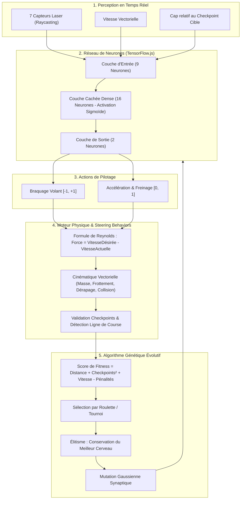

# 🏎️ Autonomous Racing Lab · Simulation IA & Championnat

[](https://developer.mozilla.org/fr/docs/Web/JavaScript)
[](https://p5js.org/)
[](https://www.tensorflow.org/js)
[](tests/)
[](#architecture-globale)
[](LICENSE)

> **Plateforme de simulation de pilotage autonome de course combinant algorithme génétique darwinien, réseau de neurones multicouche (TensorFlow.js), télémétrie laser 2D (Raycasting) et comportements de navigation vectoriels (*Steering Behaviors* de Craig Reynolds).**

---

## 📑 Sommaire
- [Aperçu du Projet](#-aperçu-du-projet)
- [Architecture Globale](#-architecture-globale)
- [Piliers Technologiques & Algorithmes](#-piliers-technologiques--algorithmes)
  - [1. Perception par Raycasting Laser](#1-perception-par-raycasting-laser)
  - [2. Cerveau Réseau de Neurones](#2-cerveau-réseau-de-neurones)
  - [3. Algorithme Génétique Darwinien](#3-algorithme-génétique-darwinien)
  - [4. Locomotion & Steering Behaviors](#4-locomotion--steering-behaviors)
- [Grand Prix & Circuits Officiels](#-grand-prix--circuits-officiels)
- [Fonctionnalités Clés](#-fonctionnalités-clés)
- [Raccourcis Clavier & Contrôles](#-raccourcis-clavier--contrôles)
- [Installation & Démarrage](#-installation--démarrage)
- [Exécution des Tests Unitaires](#-exécution-des-tests-unitaires)
- [Structure du Projet](#-structure-du-projet)
- [Références Théoriques](#-références-théoriques)

---

## 🌟 Aperçu du Projet

**Autonomous Racing Lab** simule l'apprentissage par renforcement évolutif d'une flotte de véhicules de course :
- **Aucune trajectoire n'est préenregistrée** : les véhicules ne connaissent ni la forme du circuit ni la position optimale de virage.
- **Apprentissage *from scratch*** : à la génération 0, les agents agissent de façon aléatoire et heurtent les bordures.
- **Sélection darwinienne** : les agents les plus performants (ceux qui parcourent le plus de distance et négocient les virages avec précision) transmettent leurs poids synaptiques avec d'infimes mutations.
- **Convergence rapide** : en moins de 10 générations, la population optimise ses trajectoires, dépasse les points critiques et boucle des tours complets à haute vitesse.

---

## 🧠 Architecture Globale



---

## 🔬 Piliers Technologiques & Algorithmes

### 1. Perception par Raycasting Laser
Chaque véhicule projette **7 rayons lidar directionnels** (de -60° à +60° autour de l'axe de cap) :
- Détection géométrique précise d'intersection segment-segment avec les murs intérieurs et extérieurs du circuit.
- Portée paramétrable (`SIGHT`) avec normalisation inverse $[0, 1]$ : $1.0$ = obstacle immédiat, $0.0$ = champ libre.

### 2. Cerveau Réseau de Neurones
Modèle séquentiel compact implémenté avec **TensorFlow.js** :
- **Entrées (9 inputs)** : 7 distances laser + vitesse normalisée + cap angulaire vers le checkpoint cible.
- **Couche cachée (16 neurones)** : activation non linéaire sigmoïde garantissant la stabilité des poids.
- **Sorties (2 outputs)** :
  - **Direction** $\in [-1, 1]$ : angle de braquage des roues avant.
  - **Gaz** $\in [0, 1]$ : puissance d'accélération transmise à la propulsion.

### 3. Algorithme Génétique Darwinien
- **Fitness** : pondération quadratique sur les checkpoints validés + distance continue parcourue + bonus de vitesse moyenne - pénalités de choc.
- **Élitisme strict** : le champion absolu de la génération précédente est reproduit sans altération, garantissant l'absence de régression.
- **Reproduction et Mutation** : croisement synaptique et mutation gaussienne contrôlée (taux de mutation ajustable entre $1\%$ et $20\%$).

### 4. Locomotion & Steering Behaviors
- Conforme aux travaux de **Craig Reynolds (1999)** :
  $$\vec{F}_{\text{steering}} = \vec{V}_{\text{désirée}} - \vec{V}_{\text{actuelle}}$$
  $$\vec{F}_{\text{appliquée}} = \text{truncate}(\vec{F}_{\text{steering}}, \text{maxForce})$$
- Locomotion vectorielle : masse inertielle, résistance de roulement, rebonds élastiques avec restitution d'énergie sur les bordures et conservation de l'intégrité du véhicule.

---

## 🏁 Grand Prix & Circuits Officiels

Le simulateur intègre **5 circuits professionnels réalistes** à la géométrie unique et au niveau de difficulté progressif :

| Stage | Circuit | Ambiance | Checkpoints | Murs | Difficulté | Spécificités du tracé |
| :---: | :--- | :--- | :---: | :---: | :---: | :--- |
| **#1** | **Pro Grand Prix** | Monaco Riviera | 60 | 120 | ★☆☆☆☆ | Ligne droite des stands multivoies, carrousel parabolique fluide. |
| **#2** | **Mojave Canyon** | Désertique | 60 | 120 | ★★☆☆☆ | Épingles serrées, courbes aveugles et variations de largeur. |
| **#3** | **Blackwood Ring** | Forestier | 60 | 120 | ★★★☆☆ | Chicanes techniques, enchaînement d'esses rapides. |
| **#4** | **Neo-Tokyo** | Urbain Nocturne | 60 | 120 | ★★★★☆ | Virages à 90°, freinages appuyés, zones d'évitement étroites. |
| **#5** | **Yas Marina** | SuperSpeedway | 60 | 120 | ★★★★★ | Vitesse maximale, courbes paraboliques ultra-rapides. |

---

## 🎮 Fonctionnalités Clés

- 🚦 **Procédure de Départ Officielle F1** : Portique complet à 5 paires de feux rouges avec allumage séquentiel et extinction aléatoire (*"Lights Out"*).
- 🏎️ **Grille de Départ en Quinconce** : Placement automatique de 5 à 100 voitures en formation décalée (P1, P2, P3...) alignée sur la trajectoire sans chevauchement.
- 🧠 **Visualiseur Neuronal en Direct (HUD)** : Visualisation interactive du graphe synaptique du leader, d'un bolide sélectionné ou du joueur humain en appuyant sur `N`.
- 🎮 **Mode Joueur Humain** : Prenez le contrôle de votre propre véhicule au clavier et mesurez vos réflexes face à l'IA.
- 🔊 **Moteur Audio Procédural** : Synthèse sonore temps réel via Web Audio API (bruits de moteur V6/V8, crissements de pneus, bips de départ) avec bouton Mute instantané.
- ⚡ **Accélération Temporelle** : Mode Turbo de 1x à 10x pour franchir 20 générations en quelques secondes.
- 📊 **Télémétrie Complète** : Vitesse en km/h, temps au tour, chronomètre officiel de session, compteur de survivants et classement en temps réel.

---

## ⌨️ Raccourcis Clavier & Contrôles

| Touche | Action |
| :--- | :--- |
| <kbd>Espace</kbd> | Pause / Reprise de la simulation |
| <kbd>N</kbd> | Ouvrir / Fermer le Visualiseur du Réseau de Neurones |
| <kbd>F3</kbd> ou <kbd>B</kbd> | Activer / Désactiver le mode Débogage (vecteurs, checkpoints, normales) |
| <kbd>M</kbd> | Activer / Couper le son (Mute) |
| <kbd>G</kbd> | Forcer le passage à la génération suivante |
| <kbd>R</kbd> | Réinitialiser complètement la session |
| <kbd>↑</kbd> <kbd>↓</kbd> <kbd>←</kbd> <kbd>→</kbd> / <kbd>Z</kbd> <kbd>Q</kbd> <kbd>S</kbd> <kbd>D</kbd> | Pilotage manuel du véhicule joueur |

---

## 📦 Installation & Démarrage

L'application est **100% autonome** et ne nécessite aucun outil de compilation ni dépendance lourde :

### Méthode 1 : Lancement direct dans le navigateur
Double-cliquez simplement sur [index.html](index.html) pour l'ouvrir dans n'importe quel navigateur moderne (Chrome, Edge, Firefox, Safari).

### Méthode 2 : Serveur local léger (recommandé pour les assets)
Avec Python :
```bash
# Python 3
python -m http.server 8000
```
Ou avec Node.js :
```bash
npx serve .
```
Ouvrez ensuite `http://localhost:8000` dans votre navigateur.

---

## 🧪 Exécution des Tests Unitaires

Le projet inclut une suite complète de **81 tests unitaires et d'intégration** utilisant le test runner natif de Node.js (Node 18+) :

```bash
node --test tests/*.test.mjs
```

### Couverture des tests
- ✅ **championship.test.mjs** (17 tests) : Logique de victoire, validation stricte des tours, déblocage des stages, anti-triche des checkpoints, gestion mémoire TensorFlow (`tf.dispose()`).
- ✅ **circuits_professional.test.mjs** (5 tests) : Intégrité géométrique des 5 circuits, présence physique des backgrounds HD, étalonnage des largeurs de piste.
- ✅ **starting_grid.test.mjs** (8 tests) : Placement en quinconce, respect de la surface asphaltée, synchronisation au départ (*Lights Out*).
- ✅ **collision_elimination.test.mjs** (19 tests) : Modèle d'élimination (inactivité, dégâts critiques), tolérance aux contacts légers, absence de mort prématurée.
- ✅ **collision_system.test.mjs** (6 tests) : Détection physique des collisions car-to-car, rebonds élastiques et survie.
- ✅ **race_system.test.mjs** (10 tests) : Procédure de feux de départ, gestion sonore, courses longues (1 à 30 tours), populations modulables (5 à 100 voitures).
- ✅ **telemetry.test.mjs** (16 tests) : Calcul du leader, persistance des records de score, synchronisation du dashboard HUD.

---

## 📂 Structure du Projet

```text
9-VoitureSuitCircuit genetic algo/
├── .gitignore                      # Configuration Git locale du projet
├── README.md                       # Documentation complète du projet
├── index.html                      # Page principale de l'application et HUD
├── style.css                       # Design System moderne, Dark Mode & Glassmorphism
│
├── audio.js                        # Synthèse audio dynamique (Web Audio API)
├── boundary.js                     # Primitives géométriques des barrières physiques
├── circuits.js                     # Registre et géométrie des 5 Grands Prix
├── ga.js                           # Algorithme génétique (sélection, crossover, mutation)
├── nn.js                           # Réseau de neurones artificiel (TensorFlow.js)
├── ray.js                          # Lancer de rayons laser 2D (Raycasting)
├── sketch.js                       # Orchestration générale, boucle de jeu p5.js, HUD
├── vehicle.js                      # Classe Vehicle (locomotion Reynolds, capteurs, physique)
│
├── assets/
│   └── tracks/                     # Fonds photographiques haute résolution des circuits
│       ├── bg_coastal.jpg          # Stage 1 : Pro Grand Prix
│       ├── bg_desert.jpg           # Stage 2 : Mojave Canyon
│       ├── bg_forest.jpg           # Stage 3 : Blackwood Ring
│       ├── bg_urban.jpg            # Stage 4 : Neo-Tokyo
│       └── bg_competition.jpg      # Stage 5 : Yas Marina
│
├── docs/                           # Documentation de conception détaillée
│   ├── 01_CAHIER_DES_CHARGES.md
│   ├── 02_ARCHITECTURE.md
│   ├── 03_SPECIFICATIONS_INTERFACE.md
│   ├── 04_PLAN_DES_TACHES.md
│   ├── 05_PLAN_DE_TESTS.md
│   └── 06_RESULTATS_TESTS_INITIAUX.md
│
└── tests/                          # Suites de tests automatisés (Node.js Test Runner)
    ├── championship.test.mjs
    ├── circuits_professional.test.mjs
    ├── collision_elimination.test.mjs
    ├── collision_system.test.mjs
    ├── race_system.test.mjs
    ├── starting_grid.test.mjs
    └── telemetry.test.mjs
```

---

## 📚 Références Théoriques

1. **Craig W. Reynolds (1999)** — *Steering Behaviors for Autonomous Characters*, Game Developers Conference (GDC). [Consulter la publication](https://www.red3d.com/cwr/steer/gdc99/)
2. **Kenneth O. Stanley & Risto Miikkulainen (2002)** — *Evolving Neural Networks through Augmenting Topologies (NEAT)*, Evolutionary Computation.
3. **Daniel Shiffman (The Nature of Code)** — *Genetic Algorithms & Autonomous Agents*. [natureofcode.com](https://natureofcode.com/)
4. **TensorFlow.js Core Team** — *Hardware-Accelerated JavaScript Machine Learning*. [js.tensorflow.org](https://js.tensorflow.org)

---

## 👤 Auteur & Licence

- **Projet développé dans le cadre du Master IA / Informatique Graphique & Simulation.**
- Distribué sous **Licence MIT**. Consultez le code source pour plus de détails.
