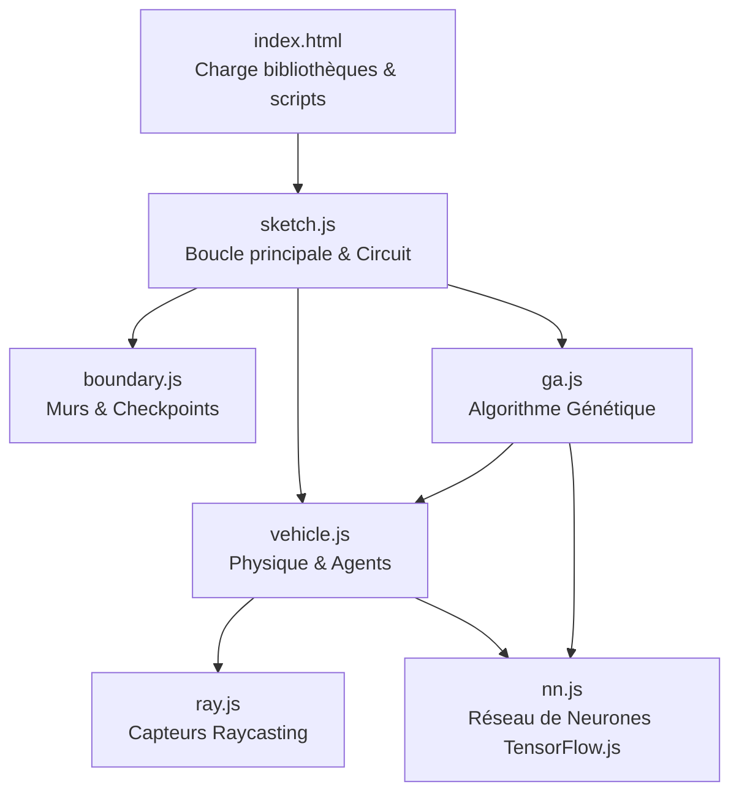
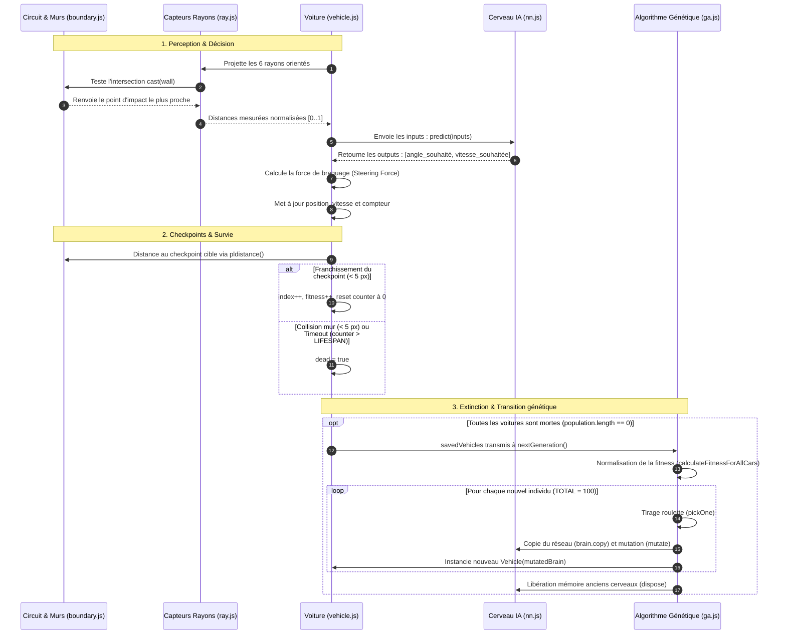

# Architecture logicielle et flux de données

## 1. Vue d'ensemble des modules

Le projet repose sur une architecture modulaire en JavaScript Vanilla exécutée dans le contexte du navigateur web, orchestrée par la bibliothèque graphique **p5.js** et la bibliothèque d'intelligence artificielle **TensorFlow.js**.

---

## 2. Rôle et responsabilités de chaque fichier

### [index.html](../index.html)
- **Rôle** : Point d'entrée de l'application web.
- **Responsabilités** :
  - Charge les CDN externes : `p5.min.js`, `p5.dom.min.js` et `tf.min.js`.
  - Définit l'ordre critique d'inclusion des scripts locaux :
    1. `nn.js` (définition de la classe `NeuralNetwork`)
    2. `ga.js` (fonctions génétiques globales `nextGeneration()`, `pickOne()`)
    3. `ray.js` (classe `Ray`)
    4. `boundary.js` (classe `Boundary`)
    5. `vehicle.js` (classe `Vehicle`, dépendant de `Ray` et `NeuralNetwork`)
    6. `sketch.js` (boucle principale `setup()` et `draw()`, instanciant tout le reste)

### [boundary.js](../boundary.js)
- **Rôle** : Définition géométrique d'un segment 2D.
- **Responsabilités** :
  - Stocke deux points vectoriels `a` ($x_1, y_1$) et `b` ($x_2, y_2$).
  - Calcule le point médian `midpoint()` (utilisé pour déterminer le point de départ `start` et d'arrivée `end`).
  - Assure le tracé graphique d'une ligne blanche via `show()`.
  - Sert indifféremment à modéliser les murs infranchissables (`walls`) et les balises de progression (`checkpoints`).

### [ray.js](../ray.js)
- **Rôle** : Télémétrie optique (Raycasting 2D).
- **Responsabilités** :
  - Part d'une position d'origine `pos` (liée à la voiture) avec un angle de visée `angle`.
  - Calcule l'intersection exacte avec un obstacle `Boundary` via la méthode `cast(wall)` basée sur les équations de déterminant de deux segments 2D.
  - Renvoie les coordonnées du point d'impact ou `null` si aucune intersection n'existe.
  - Oriente le rayon en fonction du cap du véhicule via `rotate(offset)`.

### [nn.js](../nn.js)
- **Rôle** : Cerveau computationnel de chaque voiture.
- **Responsabilités** :
  - Encapsule un modèle séquentiel TensorFlow.js (`tf.sequential()`).
  - Architecture : Couche d'entrée dense (6 neurones) $\rightarrow$ Couche cachée (12 neurones, sigmoïde) $\rightarrow$ Couche de sortie (2 neurones, sigmoïde).
  - Effectue l'inférence via `predict(inputs)` encapsulée dans `tf.tidy()` pour éviter les fuites mémoire de tenseurs.
  - Clone la structure et les poids du réseau via `copy()`.
  - Mute les poids synaptiques via `mutate(rate)` en ajoutant un bruit gaussien (`randomGaussian()`) sur les valeurs scalaires des tenseurs.
  - Libère la mémoire GPU/CPU via `dispose()`.

### [vehicle.js](../vehicle.js)
- **Rôle** : Modélisation complète de l'agent automobile.
- **Responsabilités** :
  - Gère la physique cinématique : position (`pos`), vitesse (`vel`), accélération (`acc`), bridées par `maxspeed` (5) et `maxforce` (0.2).
  - Embarque un tableau de rayons (`rays`) et une instance de cerveau (`brain`).
  - Exécute la perception de l'environnement via `look(walls)` : calcule les 6 distances normalisées (0 à 1), détecte la collision mortelle (< 5 pixels), interroge le réseau de neurones et calcule le vecteur de force directionnelle désiré.
  - Surveille la progression via `check(checkpoints)` : calcule la distance perpendiculaire point-segment (`pldistance`) au checkpoint cible actuel ; franchit le checkpoint et incrémente `fitness`.
  - Gère la fin de vie : collision avec un mur (`dead = true`) ou dépassement du temps limite sans franchir de checkpoint (`counter > LIFESPAN`).

### [ga.js](../ga.js)
- **Rôle** : Moteur d'évolution génétique.
- **Responsabilités** :
  - `calculateFitnessForAllCars()` : évalue la fitness individuelle au carré (`pow(2, fitness)`), fait la somme globale et normalise chaque fitness pour que la somme totale vaille 1.
  - `pickOne()` : implémente la sélection par roulette stochastique (probabilité proportionnelle à la fitness normalisée), puis clone le cerveau du parent et applique la mutation.
  - `nextGeneration()` : repeuple la flotte de véhicules (`population`) avec les enfants mutants et nettoie la mémoire des anciens modèles via `dispose()`.

### [sketch.js](../sketch.js)
- **Rôle** : Scène principale, générateur de monde et contrôleur d'exécution.
- **Responsabilités** :
  - `buildTrack()` : génère les points du circuit avec `p5.noise`, construit les listes `inside`, `outside`, `walls` et `checkpoints`.
  - `setup()` : configure le canvas (1200x800), force le backend CPU pour TensorFlow (`tf.setBackend('cpu')`), crée le circuit initial, instancie la première génération de 100 voitures et crée le slider de vitesse.
  - `draw()` : boucle de jeu à 60 FPS qui :
    - Fait tourner `cycles` itérations physiques selon la vitesse demandée.
    - Met à jour chaque véhicule (`applyBehaviors`, `check`, `update`).
    - Élimine les voitures mortes dans `savedVehicles`.
    - Déclenche `nextGeneration()` dès que la population active tombe à 0.
    - Dessine les murs, les checkpoints, les voitures et met en surbrillance verte (`highlight()`) le meilleur véhicule.

---

## 3. Le parcours complet des données (Dataflow)

Le cycle de vie complet d'une étape de simulation suit ce flux continu :

---

## 4. Analyse des couplages et variables globales

Dans le code existant, plusieurs variables globales partagées relient les fichiers sans passer par des arguments explicites :
- `walls`, `checkpoints`, `start` : créés dans `sketch.js`, lus directement dans `vehicle.js`.
- `TOTAL`, `MUTATION_RATE`, `LIFESPAN`, `SIGHT` : constantes déclarées dans `sketch.js`, lues dans `vehicle.js`, `ga.js` et `ray.js`.
- `population`, `savedVehicles` : tableaux déclarés dans `sketch.js`, modifiés dans `sketch.js` et consommés par `ga.js`.

Cette structure typique des projets p5.js est simple à appréhender mais demandera de la rigueur lors de l'intégration de curseurs interactifs (pour s'assurer que modifier une variable globale met à jour les comportements instantanément).
